# Hi, I'm Daniel 👋

Software Engineering Co-op student at the **University of Guelph** (graduating May 2027) and a part-time **Software Engineer at Pepper** in Toronto. Five co-op terms in, I've shipped full-stack products used by real businesses, university faculty, and healthcare teams across Canada.

I'm **looking for full-time software engineering roles starting Summer 2027.**

 

## Tech stack

 
 

Also: Fastify, Hasura, Pandas, Plotly, Selenium, BeautifulSoup, JUnit, OpenAI, Gemini, ElevenLabs, Twilio, Adyen, Plaid, Google Maps and Places, OAuth

## Projects

### AI Vacation Planner

Orchestrates AI agents to build a full day-by-day trip itinerary in **3 seconds**, with a shareable link. It combines the Google Places, Reddit, and Ticketmaster APIs with structured Gemini and OpenAI output.

[Try it](https://danieldombrovsky.com/trip-planner) · [Code](https://github.com/ddombrov/MapsProject)

 

### Splendor Duel

A web version of the two-player board game with the Counterfeiters expansion. A deterministic rules engine is shared by the browser and a Cloudflare Worker, so online games are validated server-side. It also has a computer opponent, quick match, and animations.

[Play it](https://danieldombrovsky.com/splendor-duel) · [Code](https://github.com/ddombrov/splendor)

 

### AI Voice Caller

Built at **Hack the 6ix 2024**. It automates phone calls to businesses for booking appointments and meetings, synthesizing natural, emotional dialogue with OpenAI and ElevenLabs and placing the calls over Twilio. Pick a voice and try it on my site:

   

[Try it](https://danieldombrovsky.com/call-me-maybe) · [Code](https://github.com/ddombrov/HackThe6ix2024)

 

### Canadian-Origin Barcode Scanner

A Flutter app that scans a barcode and pulls up origin and sustainability information for **1M+ products**, with social features, profile settings, and accessibility modes backed by Firestore.

[Code](https://github.com/ddombrov/oh_scanada)

 

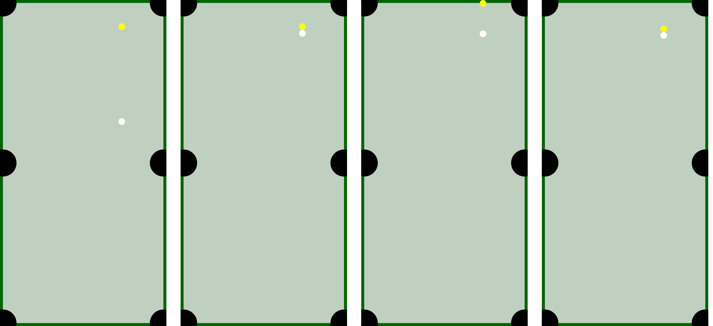

### Billiards Pool Simulator

A C physics library that simulates billiards ball collisions, connected to a Python web server that renders every shot as SVG frames in the browser.

[Code](https://github.com/ddombrov/Billards-Game)

 

### Mancala Board Game

Mancala and Ayo variants in Java with a Swing GUI, built on object-oriented design with encapsulated game state.

[Code](https://github.com/ddombrov/MancalaAndAyoGame)

 

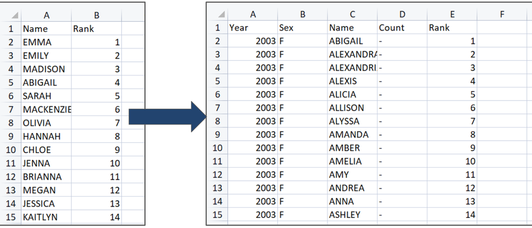

### Baby Names Frequency Tracker

A team project that analyzes name popularity and trends over time, using historical data from **10+ countries** normalized into Pandas data frames.

[Code](https://github.com/ddombrov/BabyNamesFrequencyProject)

 

### danieldombrovsky.com

My portfolio: a scrolling timeline of my journey, an AI assistant you can ask about me, and live demos of the projects above.

[Visit](https://danieldombrovsky.com) · [Code](https://github.com/ddombrov/Web)

 

## Experience

###  Software Engineer at Pepper
*Toronto · Jan 2026 to present · two co-op terms, now part-time*

- Deployed a payments processor settling **100K+ weekly transfers in 6 seconds** with TypeScript, Adyen, and Plaid
- Owned a multi-tenant customer-application platform for **8 live businesses**, with versioned forms, automated business credit checks, and FCRA-compliant bureau data per tenant
- Built a self-serve EDI dashboard that cut support tickets by **35%** across **921 suppliers**, then shipped its customer-facing successor with failure alerts and AI-generated root-cause explanations
- Shipped a route-planning dashboard that increased retention for a **$99K ARR** client

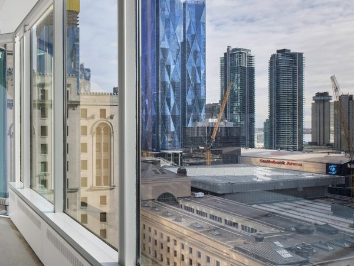 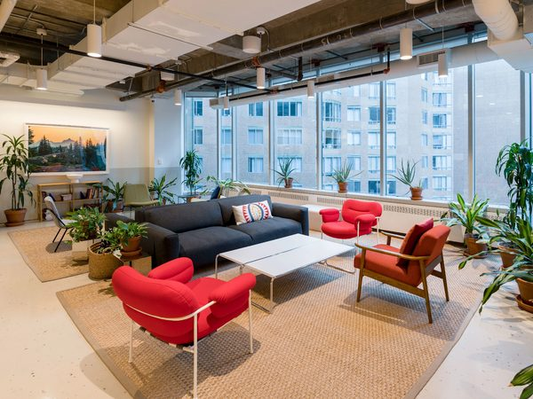

###  Software Engineer at the Canadian Institute for Health Information
*North York · May to Aug 2025*

- Automated **80%** of manual data processing with Python scripts for healthcare data-model conversions
- Designed AI workflows that automated **19 weekly review tasks** for the data team
- Contributed to national UML standards adopted by **6,000+ healthcare facilities** across Canada
- Migrated a legacy reporting service to Spring Boot, cutting maintenance costs by **30%**

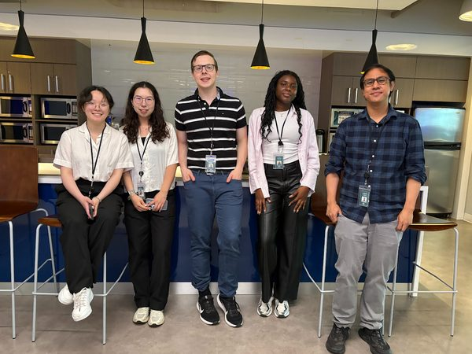

###  Head of Infrastructure at Lapis
*Guelph · Feb to Dec 2025 · part-time*

- Architected a company dashboard that cut load times from **4.9s to 200ms**
- Integrated the Notion and OneDrive APIs for one-click imports, with Google and Microsoft OAuth and role-based access control
- Automated nightly Supabase backups protecting **1.6 TB** of client data across 31 accounts

###  IT Support Technician at the City of Guelph
*Guelph · Sep to Dec 2024*

- Supported **350+ staff** across 10+ departments and onboarded **125+ new hires** with Active Directory

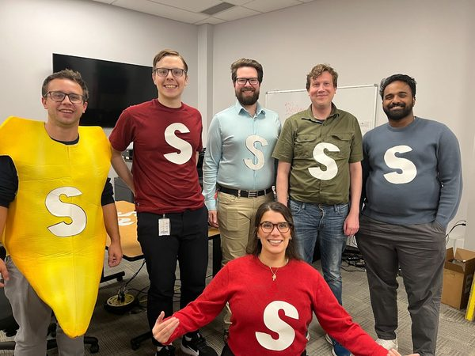

###  Software Engineer at the University of Guelph (CEPS)
*Guelph · May to Aug 2024 · nominated for Co-op Employee of the Year*

- Launched a disease-research modeling collaboration platform used by **70+ faculty members**
- Built Plotly and R dashboards for hospitalization predictions, supporting 3 active research studies
- Engineered a web scraper that cut faculty data collection time by **99%**, pulling 1,000+ Google Scholar pages in minutes

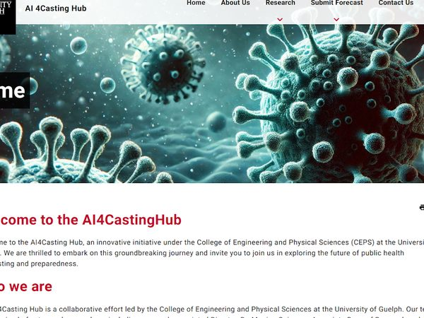

## Leadership

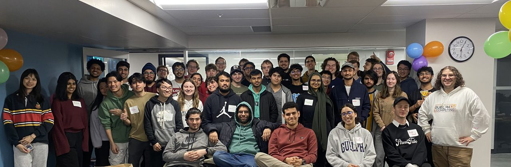

###  President of SOCIS
The University of Guelph computing students' society. I led 30 members across 5 committees, ran 16 events in a single semester, rebuilt the club's budget, launched new Guelph Computing merch, and advocated for computing students on curriculum changes. Before that, as VP Communications, I grew attendance to **70+ people per event**.

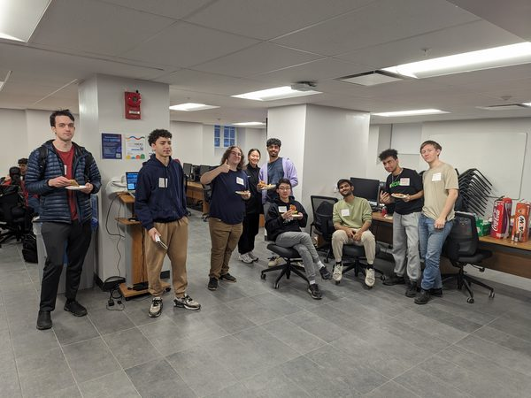 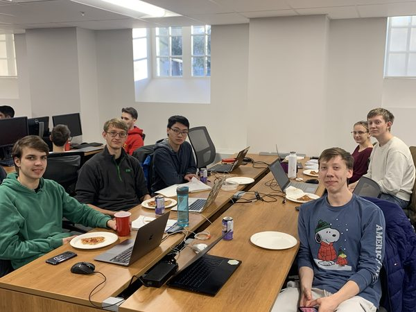

###  Marketing and Publicity Director at Google Developer Student Club
Helped organize a **200+ participant hackathon** that raised over **$25,000**, ran workshops on APIs, JavaScript, and Firebase, and volunteered at Google DevFest Waterloo 2023.

## Education and recognition

###  Bachelor of Computing, Software Engineering Co-op
*University of Guelph · Sep 2022 to May 2027 · minor in Culture and Technology Studies*

**3.84 GPA** · Entrance Scholarship · Dean's Honour List

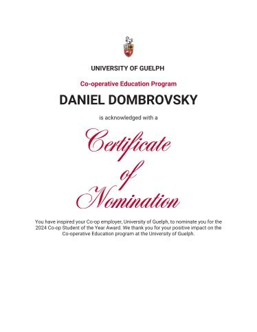 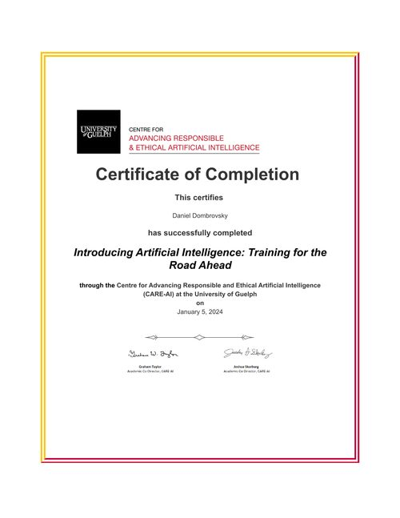

Nominated for **Co-op Employee of the Year** (2024) and certified in **Introducing Artificial Intelligence** by CARE-AI.

 

<i>See the full journey, chat with my AI assistant, and try the demos at <a href="https://danieldombrovsky.com">danieldombrovsky.com</a>.</i>

